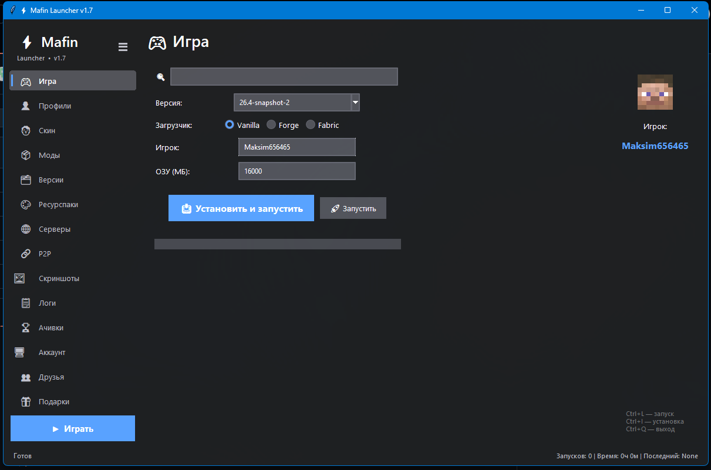
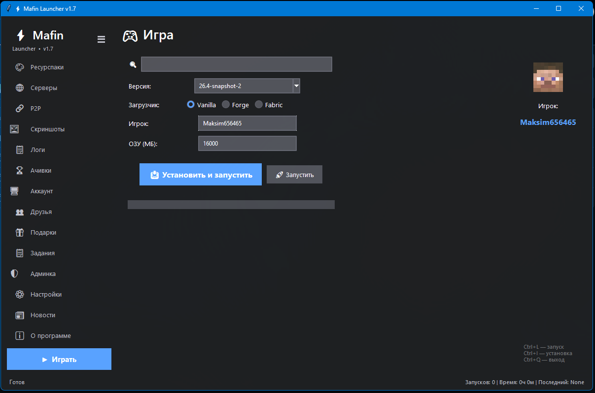
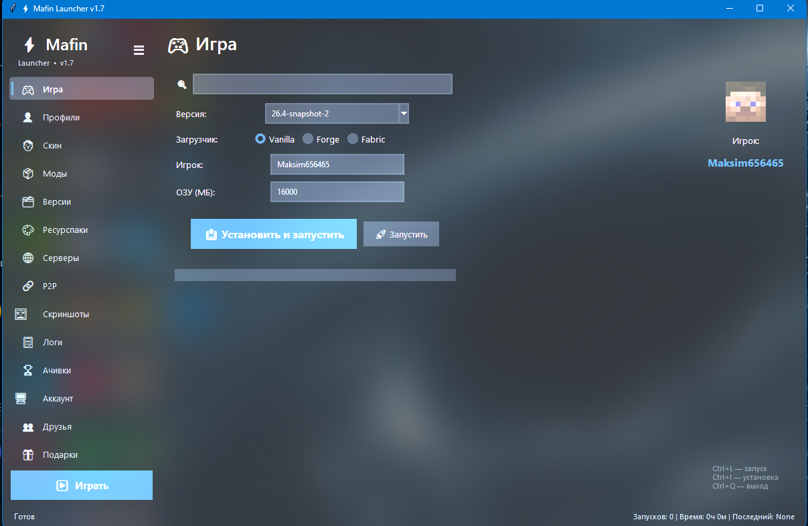
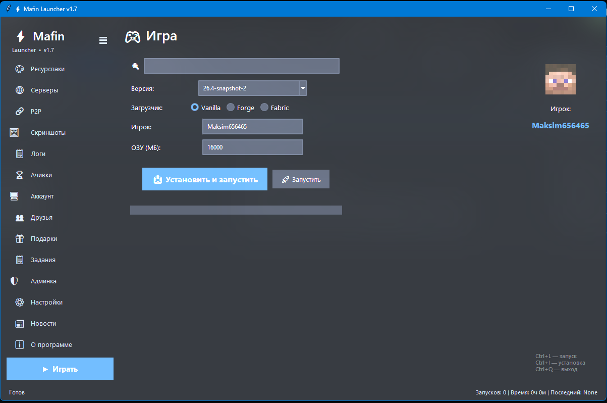

# ⚡ Mafin Launcher

Современный лаунчер для Minecraft на Python (tkinter) с оформлением в стиле Windows 11: **Mica**, **Mica Alt** и **Acrylic**.

*A modern Minecraft launcher written in Python (tkinter) with Windows 11 Mica / Mica Alt / Acrylic themes.*

Оригинальный тгк с новостями: https://t.me/mafinlauncher.

Наш сайт: https://mafinlauncher.root.sx

## ✨ Возможности

- 🎮 Установка и запуск Vanilla, Forge и Fabric
- 👤 Профили, скины, моды, ресурспаки, менеджер версий
- 🌐 Серверы, P2P, скриншоты, логи
- 🏆 Ачивки, друзья, подарки, задания
- 🔔 Вкладка уведомлений: новости и новые сообщения от друзей, счётчик друзей в сети на главной
- ☕ Java: нужная версия скачивается автоматически; если не вышло, берётся Java из системы, а потом встроенная из установщика
- 🎨 Темы: материал окна (Mica / Mica Alt / Acrylic) + 5 акцентных цветов
- 🧭 Боковое меню в трёх стилях: список, пилюли, компактное
- ⌨️ Палитра команд (`Ctrl+K`), сворачивание панели (`Ctrl+B`), запуск (`Ctrl+L`), установка (`Ctrl+I`)
- 💬 Discord Rich Presence
- (токен тг бота и юз канала указывать в app.py на 7500+ строках (найдешь)

## 🆕 Что нового

**Лаунчер**
- Новое тёмно-зелёное оформление с пиксельными рамками для всех вкладок, окон и таблиц.
- Окно входа и регистрации поверх всего лаунчера (также при слетевшей сессии) и окно уведомления об обновлении.
- Все вкладки прокручиваются вверх и вниз, в том числе экран входа.
- На главной: счётчик друзей в сети (по клику список), вкладка «Уведомления» с новостями и сообщениями от друзей с именами отправителей, в панели игры дата последнего запуска и общее число запусков.
- Скин, загруженный на сервер, сразу подгружается в 3D-сцену после входа в аккаунт.
- Вкладки «Привилегии», «Подарки» и «Задания» переделаны в карточки.
- В «О программе» вместо буквы показывается иконка `icon.ico`.
- Исправлено: после отмены скачивания кнопка «Играть» больше не запускает недокачанную игру, а предлагает доустановить её.
- Автозагрузка через Планировщик заданий (работает и на Windows 11), папка игры по умолчанию лежит рядом с лаунчером, на том же диске.

**Сервер и сайт (`app.py`)**
- Новое оформление входа, админки и страницы `/m`; на `/m` добавлены плашки «друзей в сети» и «новые сообщения».
- Новый запрос `GET /api/messages/unread_summary` (непрочитанные по отправителям), в статистике админки онлайн и сумма монет.
- Обновлена главная страница сайта: описание, таблица возможностей и шаги.

**Установка**
- Собственный установщик со встроенной Java, выбором папки и диска и удалением с вопросом про папку игры (см. раздел «Сборка»).

## 📸 Скриншоты

<p align="center">

  
  

</p>


## 🗂 Состав репозитория

| Файл | Что это |
|------|---------|
| `launcher.py` | Сам лаунчер (клиент) |
| `app.py` | Сервер: аккаунты, ачивки, друзья, подарки, новости, обновления |
| `installer.py` | Собственный установщик и деинсталлятор на tkinter (один файл, работает в двух режимах) |
| `build_installer.py` | Билдер: собирает лаунчер, деинсталлятор и установщик со встроенной Java |
| `build2.py` | Старый билдер: `MafinLauncher.exe` + установщик через Inno Setup |
| `installer.iss` | Скрипт установщика для Inno Setup (старый способ) |
| `achievement.wav` | Звук ачивок (зашивается в exe) |

## 🚫 Что не входит в репозиторий

| Файл | Почему нет |
|------|------------|
| `icon.ico` | Иконка лаунчера, права на неё не подтверждены. Положи свою рядом с `launcher.py` |
| `achievement.wav` | Звук ачивок, права на него не подтверждены. Положи свой рядом с `launcher.py` (без него лаунчер работает, просто без звука) |
| `opus.dll` | Нужна для звонков, но эта функция пока не реализована (идея на будущее). Для сборки и работы лаунчера не требуется |

## 💡 Планы

| Идея | Статус |
|------|--------|
| Голосовые звонки (на базе Opus, библиотека `opus.dll`) | Не реализовано, идея на будущее |
| Мобильная версия лаунчера | Выйдет вместе с версией v2 |

## 🚀 Запуск лаунчера из исходников

Нужны Python 3.12+ (с tcl/tk) и Java.

```bash
python -m pip install requests minecraft-launcher-lib pillow pypresence setuptools
python launcher.py
```

## 🔨 Сборка (build_installer.py)

Билдер собирает всё за один запуск: ставит недостающие зависимости, собирает `MafinLauncher.exe` (с запросом прав администратора), маленький `uninstall.exe` и установщик `MafinLauncherSetup.exe`, в который вшиты лаунчер и Java. **Собирать нужно на Windows.**

```bash
python build_installer.py --icon icon.ico
```

Результат: `dist\MafinLauncherSetup.exe`.

Что нужно положить рядом с `build_installer.py`:
- `launcher.py` и `installer.py` (обязательно);
- `icon.ico` — иконка лаунчера и установщика;
- `achievement.wav` — звук ачивок, зашивается в exe;
- `opus.dll` — если нужна, кладётся в установщик и копируется рядом с лаунчером.

| Флаг | Что делает |
|------|------------|
| `--icon icon.ico` | Иконка для лаунчера, установщика и деинсталлятора |
| `--java N` | Версия встроенной Java (по умолчанию 25, Temurin JRE) |
| `--jre-url URL` | Прямая ссылка на zip с JRE для Windows x64 |
| `--jre-zip файл.zip` | Готовый zip с JRE вместо скачивания |
| `--no-java` | Не вшивать Java |
| `--skip-launcher` | Не пересобирать лаунчер, взять готовый `dist\MafinLauncher.exe` |

Скачанная Java кэшируется в `build_cache\`. Если автоматическое скачивание не работает, возьмите JRE (zip, Windows x64) на [adoptium.net](https://adoptium.net/temurin/releases/) и передайте через `--jre-zip`.

### Что умеет установщик

- Папку установки и диск выбирает пользователь (по умолчанию `%LOCALAPPDATA%\Programs\Mafin Launcher`). Перед установкой проверяются диск, права записи и свободное место.
- Проверяет Java в системе. Если её нет или она старше 17, ставит встроенную в подпапку `java`.
- Создаёт ярлыки, при желании включает автозапуск, добавляет запись в «Параметры → Приложения».
- Повторный запуск установщика, когда лаунчер уже установлен, предлагает только удаление. При удалении можно отметить, стирать ли папку игры и настройки.
- Данные игры лаунчер хранит рядом с exe, на том же диске, и не пишет в AppData.

### Автозагрузка

Лаунчер собирается с правами администратора, а такие программы Windows не запускает через ветку реестра `Run`. Поэтому галочка автозапуска создаёт задачу в Планировщике («при входе, с наивысшими правами»); если задачу создать не удалось, используется запись в реестре.

### Старый способ (Inno Setup)

`build2.py` и `installer.iss` оставлены для сборки установщика через [Inno Setup 6](https://jrsoftware.org/isinfo.php): `python build2.py [--icon myicon.ico] [--exe-only] [--no-admin]`.

## 🖥 Сервер (app.py)

Бэкенд на **Flask + SQLite**: регистрация и вход, профили, достижения и топ, друзья и сообщения, подарки, задания, новости, раздача обновлений лаунчера и веб-админка (`/admin`).

```bash
python -m pip install flask
python app.py
```

Сервер слушает порт `10074` (`0.0.0.0`). Рядом создаются папка `updates/`, файл `.secret_key` (подпись сессий админки) и база `mafin_launcher.db`. Путь к базе по умолчанию **относительный** (от текущей папки), поэтому запускайте сервер и все команды `app.py` из одной и той же папки или задайте `MAFIN_DB_PATH` с полным путём.

### 🔐 Доступ в админку

В коде и переменных окружения **нет паролей админа**. Вход в `/admin` идёт по одноразовому коду, который можно получить только на самом сервере (то есть нужен SSH-доступ):

```bash
python app.py admin-code Ник --create   # первый раз: создаёт админа без пароля и выдаёт код
python app.py admin-code Ник            # дальше: новый код для существующего админа
```

1. Команда печатает код вида `E3TYR-HTPJJ`. Он живёт 5 минут и срабатывает один раз.
2. Откройте `/admin`, введите ник и код. Сессия админки живёт **30 дней**, потом нужен новый код.
3. В админке, в блоке «🔑 Пароль для лаунчера», задайте пароль (от 10 символов). После этого в лаунчер можно входить по нику и паролю. Пока пароль не задан, войти в лаунчер по этому нику нельзя.
4. Смена пароля там же требует текущий пароль.

Неверные попытки входа ограничиваются отдельно по нику и по IP.

### 🧰 Команды на сервере

| Команда | Что делает |
|---------|------------|
| `python app.py admin-code Ник` | Выдаёт одноразовый код для входа в `/admin` (админ должен существовать) |
| `python app.py admin-code Ник --create` | То же, но создаёт админа без пароля или выдаёт права существующему профилю |
| `python app.py set-password Ник` | Задаёт новый пароль лаунчера (ввод скрыт, от 12 символов), сбрасывает токен |

### 🛡 Если что-то утекло

- **Сессия или пароль игрока:** в `/admin` у каждого пользователя есть «Сбросить сессию» (выкидывает из лаунчера) и «Сменить пароль». Пароль другого админа отсюда менять нельзя: он меняет свой в блоке «Пароль для лаунчера», а владелец сервера может командой `set-password`.
- **Свой токен лаунчера:** кнопка «Сбросить мою сессию в лаунчере» в `/admin`.
- **Веб-сессия админки:** удалите `.secret_key` и перезапустите сервер, все админы будут разлогинены и получат новые коды.
- **Админ потерял доступ:** `python app.py admin-code Ник` даёт новый вход, `set-password` задаёт новый пароль.

### ⚙️ Переменные окружения

Все необязательные:

| Переменная | Назначение |
|------------|------------|
| `MAFIN_SECRET_KEY` | Ключ подписи сессий веб-админки. Если не задан, берётся из файла `.secret_key` (создаётся при первом запуске с правами 600) |
| `MAFIN_DB_PATH` | Путь к файлу базы данных (по умолчанию `mafin_launcher.db` в текущей папке) |
| `MAFIN_HTTPS` | Поставьте `1`, если сервер за HTTPS: cookie админки станут `Secure` |

### 🌍 Безопасность на рабочем сервере

- Поставьте сервер за HTTPS (nginx или Caddy) и задайте `MAFIN_HTTPS=1`.
- Админка нужна только администраторам, поэтому её удобно закрыть от интернета: в nginx разрешить `/admin` только с вашего IP, либо ходить по SSH-туннелю (`ssh -N -L 8080:localhost:10074 user@сервер`, затем `http://localhost:8080/admin`). Лаунчер использует только `/api/*`.
- За nginx для лимита попыток по IP приложению нужен реальный адрес клиента, а не `127.0.0.1`; без этого лимит по IP будет общим на всех, а лимит по нику продолжит работать.
- На VDS отключите вход по паролю в SSH (`PasswordAuthentication no`) и заходите по ключам.

Адрес сервера для лаунчера задаётся в `launcher.py` (константа `SERVER_URL`).

## 🪟 Про темы

Mica Alt работает на Windows 11 22H2 и новее, Mica — на Windows 11, Acrylic — на Windows 10 1803+. Если эффект не поддерживается, лаунчер автоматически переключается на классический фон.

## 📄 Лицензия

MIT — см. файл [LICENSE](LICENSE).
